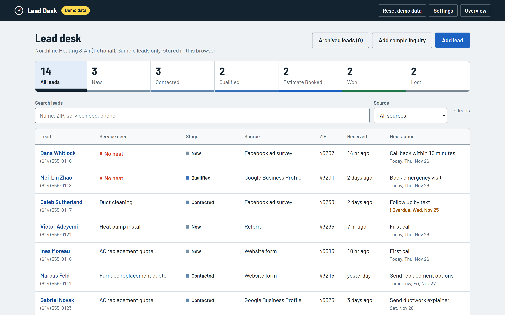
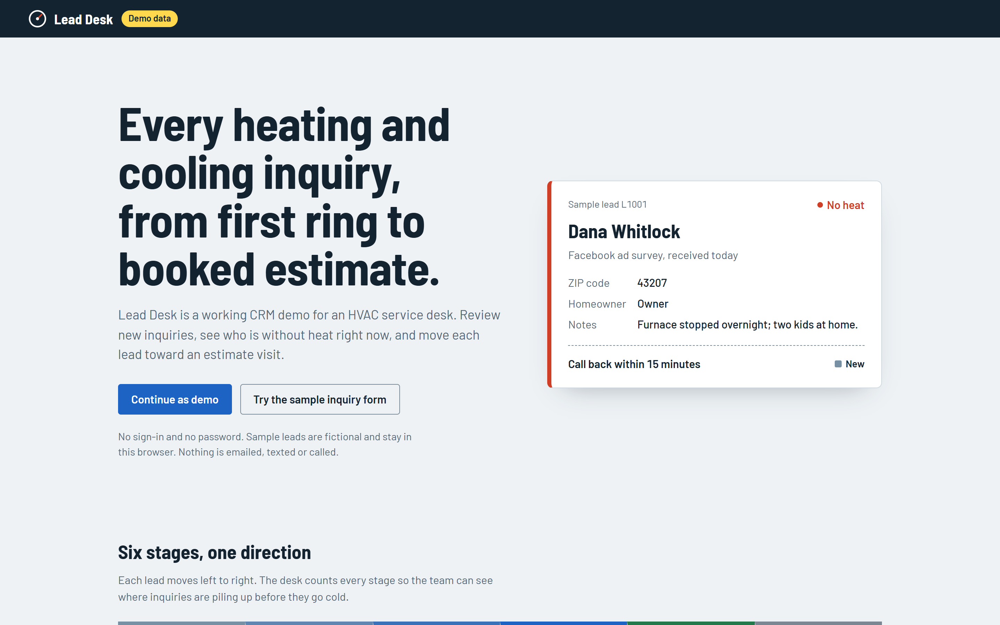
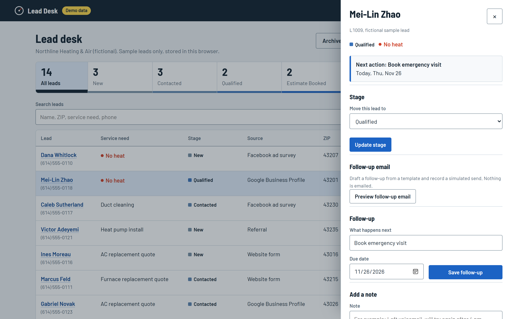
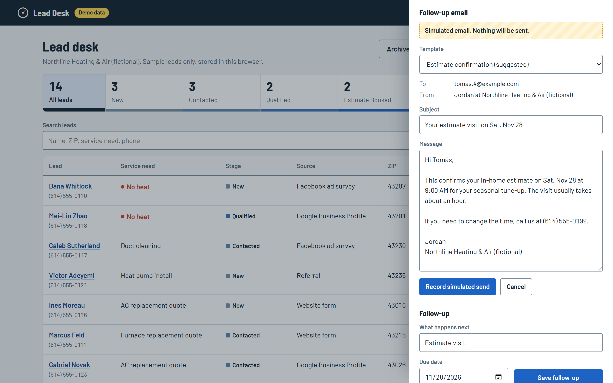
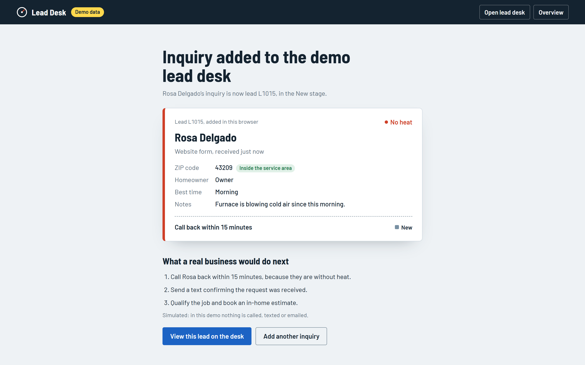
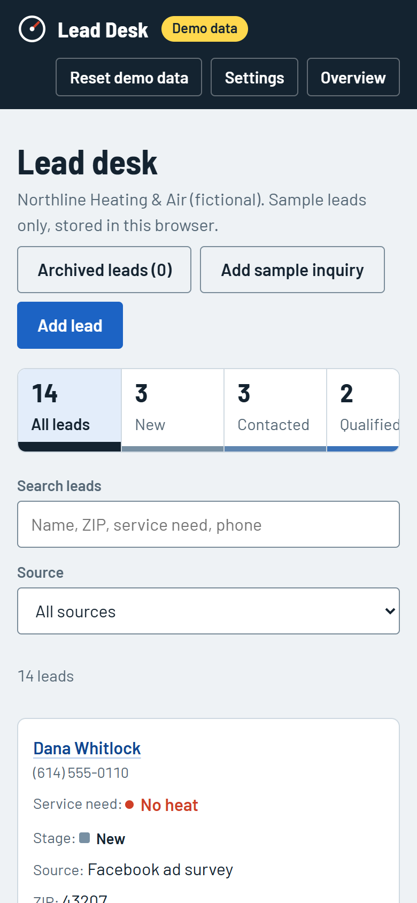

# Lead Desk

> A small browser-only CRM demo for an HVAC service desk, built around the stretch between a new inquiry and an estimate visit.

**Independent portfolio demonstration.** Every business, lead, name, phone number and email in Lead Desk is fictional. No email, text, call or ad is ever sent, and nothing you enter leaves your browser. The demo shows a workflow; it has not been used with real customers, and it reports no real results.



## Why I built it

I wanted to make a demo that feels like a real workday problem: a no-heat request arrives beside a routine tune-up, and someone still needs to know who to call next. Lead Desk is my take on keeping those inquiries and follow-ups in one place:

- **Urgency comes first.** Leads without heat or cooling are marked in red and sorted to the top, followed by overdue follow-ups.
- **The pipeline is visible at a glance.** A stage strip counts every lead in each of six stages and doubles as a filter.
- **Follow-up has a place to happen.** Each lead carries a next action and due date, and suggests a follow-up email from its stage, which you can record as a simulated send.

I kept the app small and used plain HTML, CSS and JavaScript. You can click through the workflow, or read the code without setting up a framework. I wrote more about the decisions and trade-offs in the [case study](docs/CASE_STUDY.md).

## Features

- **Landing page and "Continue as demo".** No sign-in and no password.
- **Lead desk.**
  - 14 fictional sample leads, with search across name, phone, email, ZIP, service and notes.
  - A source filter and a stage strip that combine with the search.
  - Overdue follow-ups marked in amber.
- **Lead detail panel.**
  - Change the stage; Estimate Booked asks for a visit time and Lost asks for a reason.
  - Edit details, add notes, and set a follow-up with a due date.
  - Archive a lead and restore it later.
  - A full activity history, including when each change was made.
- **Sample inquiry form.**
  - A customer-facing form with "Fill with sample details", inline validation and an urgent-need notice.
  - A ZIP check against the service area.
  - A confirmation screen that hands the inquiry off to the desk.
- **Simulated follow-up emails.**
  - Six templates, with one suggested for the lead's stage and service.
  - Fill-in fields for the lead's details, and visible gaps such as `[estimate date]` for anything the lead doesn't have yet.
  - The email can be edited before recording; "Record simulated send" only writes to the activity history.
  - A New lead moves to Contacted, and you're offered the next follow-up.
- **Settings.**
  - Business name, always shown with "(fictional)"; sender; a phone number in the fictional 555-01xx range.
  - Service-area ZIPs, the default follow-up gap, and an editor for the email templates.
  - "Reset demo data".
- **Responsive and keyboard-accessible.** See [Accessibility](#accessibility).

## Quickstart

Requires [Node.js](https://nodejs.org/) 18 or later, only to run the tiny local server. There are no dependencies to install.

```bash
git clone <this-repo-url> lead-desk-crm-demo
cd lead-desk-crm-demo
npm start
```

Expected output:

```
Lead Desk demo: http://localhost:5173
```

Open http://localhost:5173 and choose **Continue as demo**.

No Node? Open `index.html` directly in a browser. Everything works from the file, though some browsers keep separate demo data for files opened this way.

## A two-minute walkthrough

1. **Continue as demo** opens the desk. Dana Whitlock (no heat) is at the top, and Caleb Sutherland's follow-up is overdue.
2. Click **Estimate Booked** in the stage strip to filter, then **All leads** to clear it.
3. Open **Priya Raman**, move her to **Estimate Booked** and pick a visit time. Watch the counts and the activity history update.
4. In the same panel, choose **Preview follow-up email**. The *Estimate confirmation* template is suggested, with the visit date filled in. Edit it if you like, then **Record simulated send**.
5. Choose **Add sample inquiry**, then **Fill with sample details**, and submit. The confirmation screen shows the service-area result. **View this lead on the desk** opens the new lead.
6. Open **Settings**, change the business name or service area, and save. The desk, the emails and the ZIP checks all follow.
7. **Reset demo data** restores everything.

| | |
|---|---|
|  |  |
|  |  |



## Demo limitations

These are deliberate. See the [functional requirements](docs/FRD.md), §1.4 and §2.

- **Browser-local only.** Data lives in `localStorage` in one browser. It is not shared between devices or people, and clearing site data erases it. If storage is blocked (for example in some private windows), the demo still works for that visit only.
- **No real accounts or authentication.** "Continue as demo" is the only way in.
- **Nothing is sent.** There is no email, SMS, phone, calendar, ad-account or CRM integration. Simulated emails are stored on the lead and labeled "Not sent".
- **No backend, analytics or tracking.** The only external request is the Google Fonts stylesheet; without it, the app falls back to system fonts.
- **Fictional data.** Sample phone numbers use the 555-0100 to 555-0199 range reserved for fiction, and emails use `example.com`. The demo forms say to use made-up details. Visitors could still type real ones, but those would never leave their browser.
- **No measured results.** Stage counts describe the sample data only.

## Architecture

A static site: one HTML page, one stylesheet, three plain scripts. No framework and no build step, so the code reads top to bottom.

```
index.html          Page shell: top bar, <main>, toast
css/styles.css      Design tokens (:root), layout, components, responsive rules
js/data.js          Fictional seed leads, stages, sources, email templates, default settings
js/store.js         localStorage load/save, versioned upgrades, reset, next lead ID
js/app.js           Hash router, screens, forms and validation, simulated email logic
scripts/serve.js    Zero-dependency static server for local preview (npm start)
scripts/screenshots.mjs  Re-captures docs/screenshots with headless Edge/Chrome
docs/FRD.md         Functional requirements, milestones and acceptance checklist
```

**How it fits together**

- **Routing.** URL hashes pick the screen: `#/`, `#/desk`, `#/desk/L1004` (a lead's panel), `#/desk/new`, `#/inquiry`, `#/inquiry/added/L1015` and `#/settings`. Lead panels have their own URL, so they survive a reload and can be linked.
- **State.** One object `{ version, demoStarted, settings, leads[] }` is saved under a single `localStorage` key after every change. `store.js` upgrades data saved by older versions, so returning visitors keep their demo workspace.
- **Activity history.** Every change appends an entry, such as a stage change, note, edit, follow-up, service-area check or simulated email. The lead's history is the record of what happened, the way a real CRM keeps one.
- **Simulated email.** Templates use `{{merge_fields}}`. A field the lead doesn't have yet renders as a visible gap such as `[estimate date]`, and recording is blocked until it is filled in or removed. Recording stores `{ to, from, subject, body, templateId }` on the lead and never calls a mail API or `mailto:`.
- **Safety.** All user-entered text is escaped before rendering; there is no `eval` and no inline handlers built from user data.

### Design notes

The palette borrows from an HVAC gauge manifold. Low-side blue marks actions. High-side red is reserved for leads without heat or cooling. Amber marks overdue follow-ups, so urgency and lateness never look the same. The type is Barlow, a grotesk modeled on highway signage, in one family. The stage strip is drawn as one continuous run, like ductwork, and on phones it scrolls sideways as a single row.

## Accessibility

- All controls work by keyboard, with a visible focus ring and a skip link.
- The lead panel is a modal dialog. Focus moves into it and stays inside while it's open, the page behind it is inert, Escape closes it, and focus returns to the lead you opened.
- Form errors appear next to each field, linked with `aria-describedby`, and focus moves to the first error.
- Result counts and toasts are announced through live regions.
- Color is never the only signal; urgent, overdue and stage states also carry text.
- Text contrast meets WCAG AA (lowest pair 4.65:1). Control borders meet the 3:1 rule for non-text elements.
- Animations are disabled under `prefers-reduced-motion`.
- The layout is checked at 375px wide with no horizontal page scroll; the lead table becomes labeled cards.

These were checked in the browser during development. A screen-reader pass with NVDA or VoiceOver has not been done yet.

## Deploying

Lead Desk is static, so any static host works. On Vercel, import the repository with no framework preset, no build command, and the project root as the output directory. The included `vercel.json` adds basic security headers. On Netlify or GitHub Pages, publish the repository root.

## Regenerating screenshots

With `npm start` running in one terminal:

```bash
node scripts/screenshots.mjs docs/screenshots
```

It uses the installed Microsoft Edge by default. Set `BROWSER` to another Chromium browser's path to use that instead.

## Contributing

This is a personal portfolio project, so it isn't seeking contributions. Feedback and issues are welcome. If you fork it, keep the demo labels and the fictional data in place.

## License

Lead Desk is licensed under the MIT License. See [LICENSE](LICENSE) for the full text.

I designed and built Lead Desk as an independent portfolio project, with AI coding assistance. It is not affiliated with any HVAC business.
