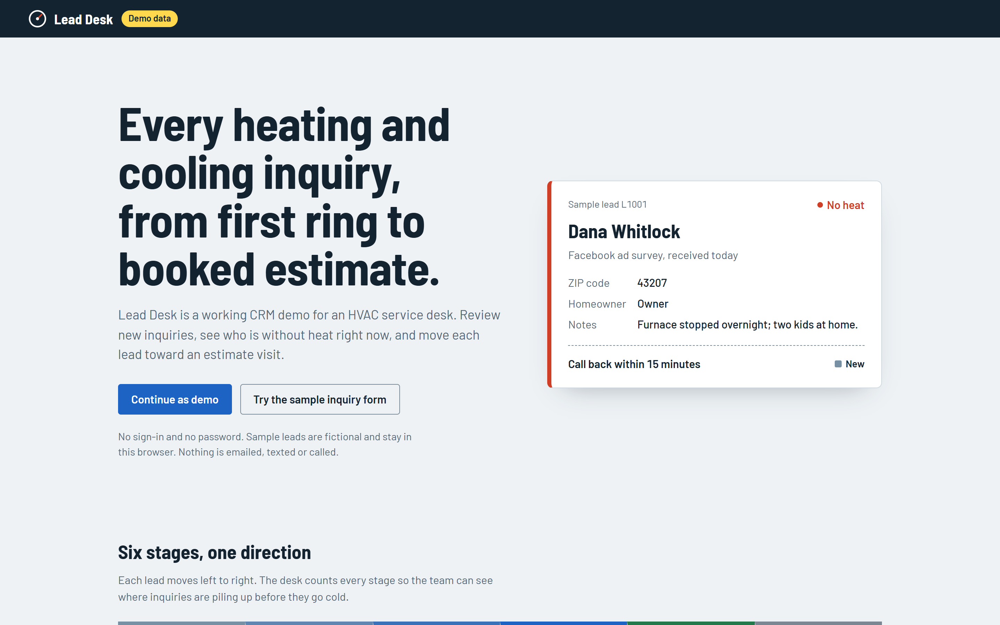
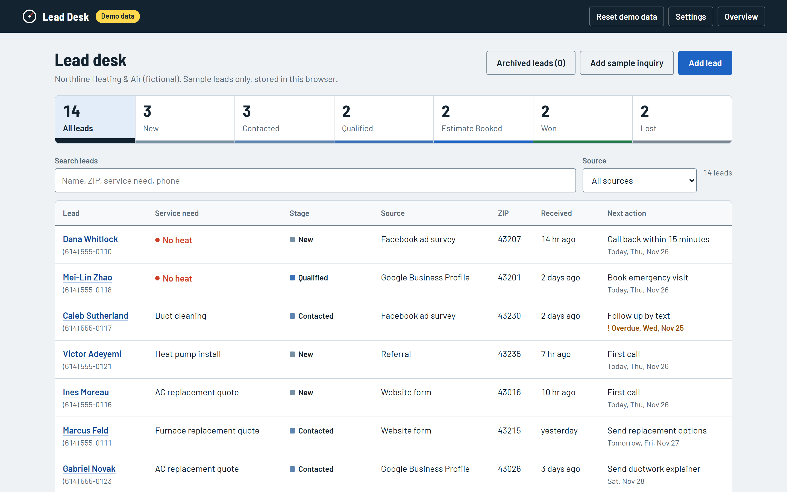
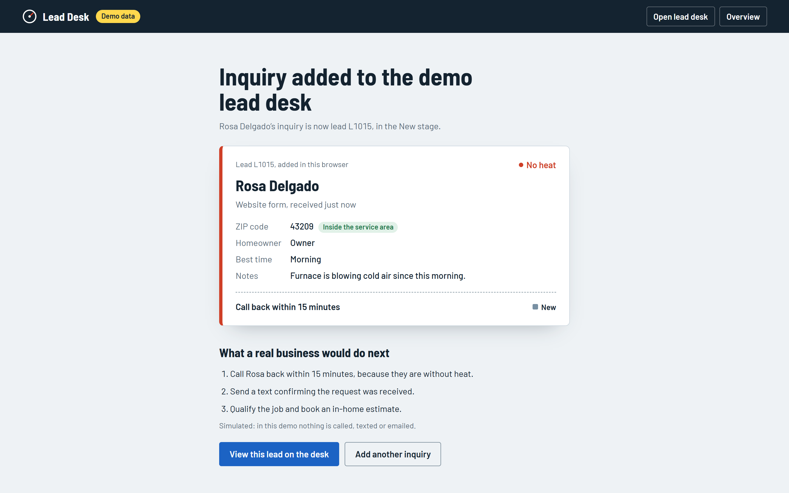
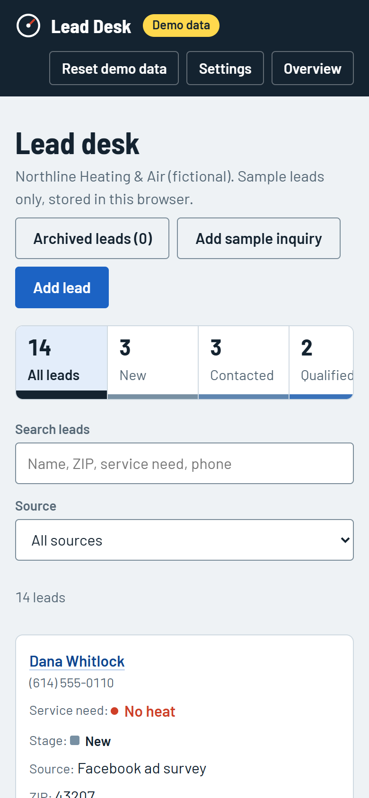

# Case study: Lead Desk

**An HVAC lead-to-estimate CRM demo**

## Quick facts

- **Role:** I led product design, requirements and front-end development, with AI coding assistance
- **Context:** Independent portfolio project. It is not client work and is not affiliated with any HVAC business.
- **Timeline:** Five milestones, from a written spec to a deploy-ready build
- **Stack:** Plain HTML, CSS and JavaScript; no framework, no build step, no runtime dependencies
- **Outcome:** A working, responsive, keyboard-accessible demo of the inquiry-to-estimate workflow, with every record fictional and every email simulated

> **Honesty note.** Lead Desk has not been used with real customers. It reports no conversion, response-time or revenue results, and none should be inferred from its sample data.

---

## Overview

I built Lead Desk around one practical question: after a heating or cooling inquiry comes in, can the person handling it quickly see what needs attention and what to do next?

1. An inquiry comes in.
2. Anyone without heat is at the top of the list.
3. Every lead has a next action and a due date.
4. A follow-up email is one click away.

The emails are simulated: they are recorded on the lead and never sent.

I wanted this to be more than a static mockup. The sample data lets someone try the full path from inquiry to estimate follow-up, while the labels make clear that it is a fictional demo.

## The problem

For the demo, I pictured a small HVAC office getting estimate requests from a website form, phone calls, social media and referrals. I focused on three everyday problems:

- **Urgency gets lost.** A family with no heat in November sits in the same list as someone asking about a thermostat upgrade.
- **Follow-up depends on memory.** Nobody owns the next step, so leads quietly go cold between "contacted" and "estimate booked".
- **No one can see the pipeline.** Without stage counts, the team can't tell whether inquiries are piling up at first contact or at booking.

**What I wanted to show:** the inquiry → qualification → follow-up → booked-estimate workflow, in a form that:

- is easy for a recruiter or hiring manager to try
- gives an implementation team something concrete to review
- feels familiar to someone who has handled service inquiries

**Constraints I set before writing code:**

- **Fictional data, clearly labeled.** Phone numbers are in the 555-01xx range reserved for fiction, emails are at `example.com`, and a "Demo data" label appears on every screen.
- **Nothing leaves the browser.** There is no backend, no sign-in and no passwords.
- **Nothing is sent.** No email, SMS, calls, calendar connections or ad accounts.
- **No invented results anywhere,** including in this write-up.

## Process

### Requirements early

I first made a read-only version to settle the layout and data shape. Before adding editing, I wrote a [functional requirements document](FRD.md) with 61 numbered requirements and an acceptance checklist. Writing it down surfaced details I might otherwise have skipped:

- What does "Estimate Booked" require? A visit date and time.
- What happens to a lost lead? It must record a reason.
- Does recording an email move a lead's stage? Only New moves to Contacted.

I worked through five milestones and checked each one in the browser:

1. Read-only desk: landing page, sample data, filters, detail panel
2. Editing: stages, notes, follow-ups, add lead, archive and restore
3. Sample inquiry form with a service-area check
4. Simulated follow-up emails and Settings
5. Accessibility audit, screenshots, README, deploy prep

### Key decisions

**Plain JavaScript.** The demo has a handful of screens and one saved data object, so I kept it framework-free. That means no build step or runtime dependencies, and the files are easy to browse. User-entered text is escaped before it is shown on the page.

**Urgency and lateness are different colors.** The palette comes from an HVAC gauge manifold:

- **Red** (the high-pressure side) marks only leads without heat or cooling.
- **Blue** (the low-pressure side) marks actions.
- **Amber** marks overdue follow-ups.

I kept urgent and late visually distinct: a red row means a no-heat or no-cooling request, while amber means a follow-up is overdue. Both also have text labels, so color isn't doing all the work.

**The stage strip is both a dashboard and a filter.** Instead of a separate chart, the six stages sit in one continuous strip, drawn like a run of ductwork, with a count in each section. Clicking a stage filters the table, so seeing a bottleneck and acting on it is the same click.

**Simulated email has to stay honest.**

- The composer carries a striped "Simulated email. Nothing will be sent." banner.
- The action is labeled "Record simulated send", not "Send".
- Each recorded email is stored with "Not sent" in the lead's activity history.

The suggested template follows the lead's state: an urgent callback for no heat, an estimate confirmation once a visit is booked, a check-in when a follow-up is overdue.

**Missing details are visible.** If a template needs a detail the lead doesn't have, such as the estimate date, the draft shows a visible gap like "[estimate date]". Recording is blocked until it's filled in or removed. A silent blank would be the mistake that embarrasses a real business in front of a customer.

**Settings protect the fiction.** The business name is always shown with "(fictional)", and the business phone is rejected unless it's in the 555-01xx range. The constraints are built into the product, not left to good intentions.

**Deployment protects private files.** A static host publishes every file in the repository by default. Before deploying, I added rules to keep the planning brief and tooling folders off the live site. I also made the local server apply the same security headers as production, so the content-security policy was tested before anything went live.

## Solution

### The lead desk

- 14 fictional leads across six stages and five sources.
- Search covers name, phone, email, ZIP, service and notes, and combines with the source filter and stage strip.
- Sorting puts no-heat and no-cooling leads first, then overdue follow-ups, then the newest.
- Archive hides a lead without deleting it; restore brings it back.

### The lead record

- **Stages:** changes are validated; Estimate Booked asks for a visit time and Lost asks for a reason.
- **Editing, notes and follow-ups:** field-level error messages, and focus moves to the first problem.
- **Activity history:** each stage change, note, edit, follow-up, service-area check and simulated email is logged with when it happened.
- **Shareable state:** each lead has its own URL, so the panel survives a reload.

### Simulated follow-up email

- Six templates, with one suggested for the lead's stage and service.
- Fill-in fields such as the first name, the service written into a sentence ("heating outage"), and the estimate date and time.
- Editable before recording; a New lead moves to Contacted, and the next follow-up is offered automatically.

### Lead capture

- A customer-facing sample form with a "use made-up details" notice and a "Fill with sample details" button.
- The ZIP is checked against the service area. A lead from outside the area is still accepted, just flagged, because a lost lead is worse than a lead that needs checking.
- A confirmation screen explains what a real business would do next and hands the new lead to the desk.

### Built for every screen

- On phones, the table becomes labeled cards, and the stage strip becomes one row you can swipe through.
- The lead panel works as a proper dialog: focus moves into it and stays inside, the page behind is inert, and Escape closes it and returns focus to the lead you opened.

## Results

I haven't tested this with customers, so I don't have business results to claim. Here are the checks I can report about the build:

| What | Result |
|---|---|
| Requirements | 61 numbered requirements written; all five milestones delivered and tested in the browser |
| Dependencies | None at runtime; no build step |
| Page weight | 108 KB uncompressed, 28 KB gzipped, excluding fonts. My own target was 100 KB uncompressed, so I missed it slightly; the gzipped download is well under. |
| Text contrast | Meets WCAG AA on every screen; lowest pair 4.65:1 |
| Control contrast | Input borders raised from 2.2:1 to 3.4:1 after the audit, to meet the 3:1 rule for controls |
| Privacy | The only network requests are the page's own files and Google Fonts; no lead data is ever sent |
| Phone layout | Works at 375px wide with no horizontal page scroll |

**What has not been tested:**

- conversion or response-time impact
- usability with HVAC office staff
- a full screen-reader pass with NVDA or VoiceOver

## Learnings

**What worked for me**

- **Writing the FRD early.** Most of the interesting decisions were made in writing, before the code that needed them: the estimate date, the lost reason, gaps in email drafts, the fictional phone range. Building then became a matter of following the document.
- **Small milestones with a browser check at the end.** Working in small steps helped me catch issues as I went:
  - the desk opened halfway down the page after leaving the landing screen
  - one archived lead was labeled "1 archived leads"
  - an email template produced "a AC replacement"
  - an accented name came out wrong in a sample email address
  - a notification and test data showed up in screenshots
- **Building the honesty into the product.** Because the fictional labels, phone-range validation and "Not sent" records are part of the app, the demo can't be mistaken for real results, even out of context.

**What I'd do differently**

- **Accessibility from milestone one, not milestone five.** The contrast and dialog fixes were small, but they would have cost nothing if they'd been in the original design tokens.
- **Set the page-weight target with real numbers.** I set the 100 KB target before the email templates existed. Measuring after milestone two would have given a realistic budget.
- **Test with a screen reader as I go,** not as a later follow-up.

**Next steps**

- Usability sessions with people who run an HVAC office, to see whether the stage strip and urgency sorting match how they actually triage.
- A speed-to-lead workflow (the next project in the series), connecting the inquiry form to a simulated first response and team alert.
- An estimate-booking mini-app, which would replace the date-and-time field with real availability.

---

**Links:** [Live demo](#) (add after deploy) · [Source code](../README.md) · [Functional requirements](FRD.md)

*All names, phone numbers, emails and businesses shown are fictional. Screenshots are from the demo's sample data.*
